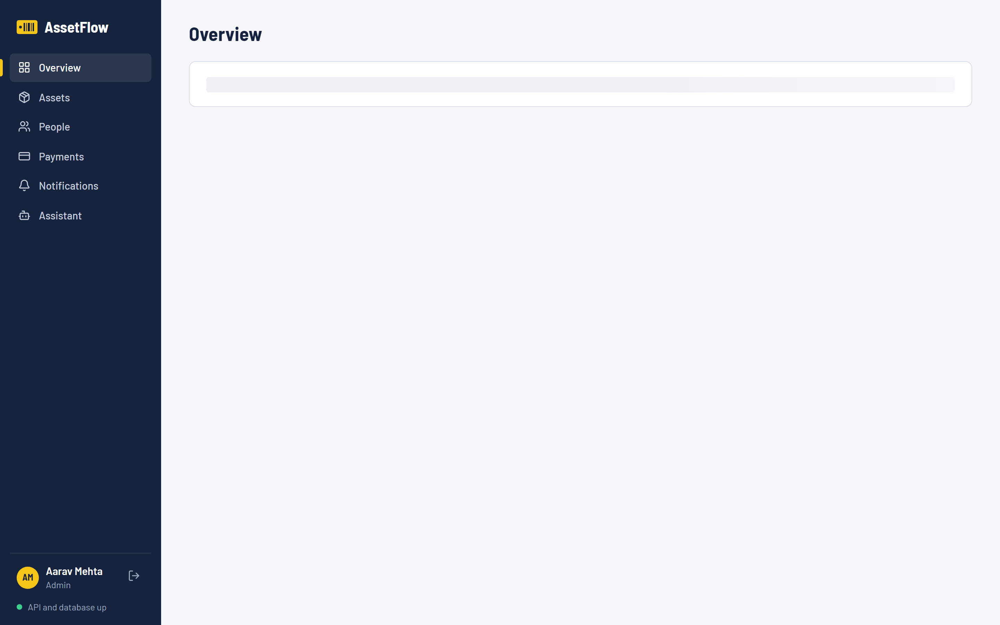
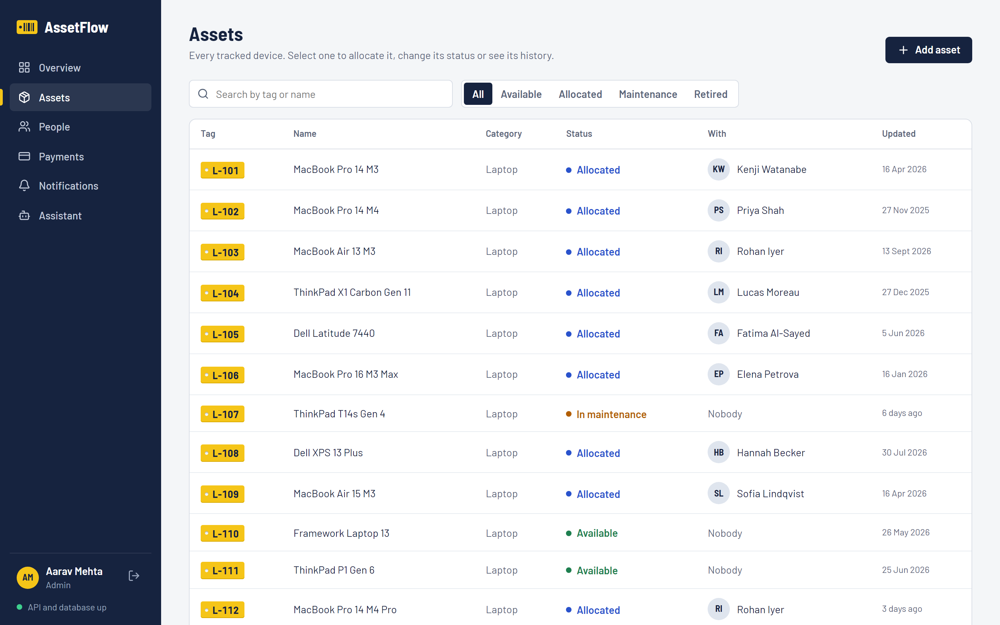
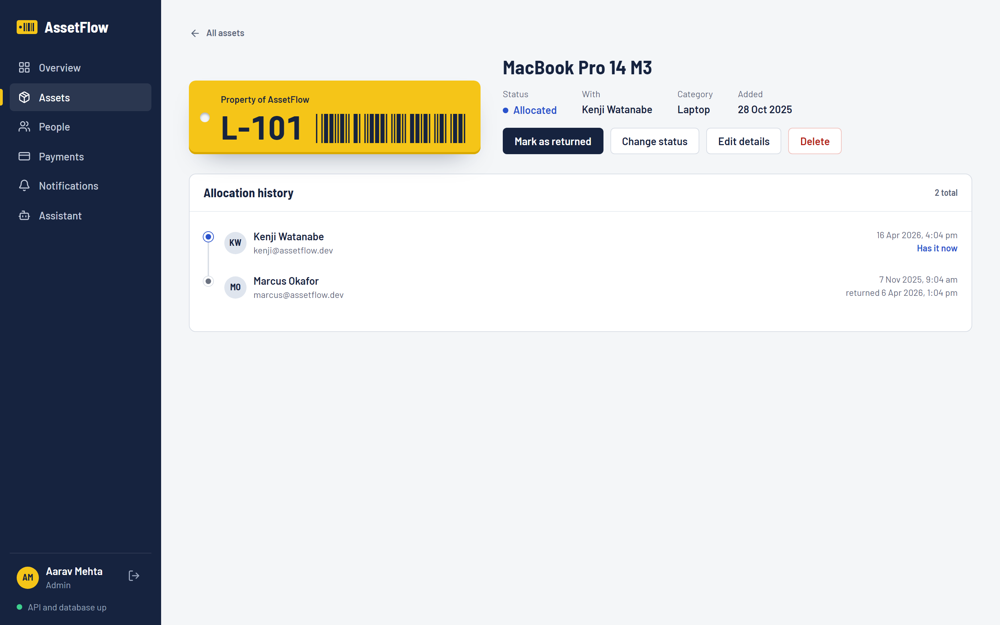
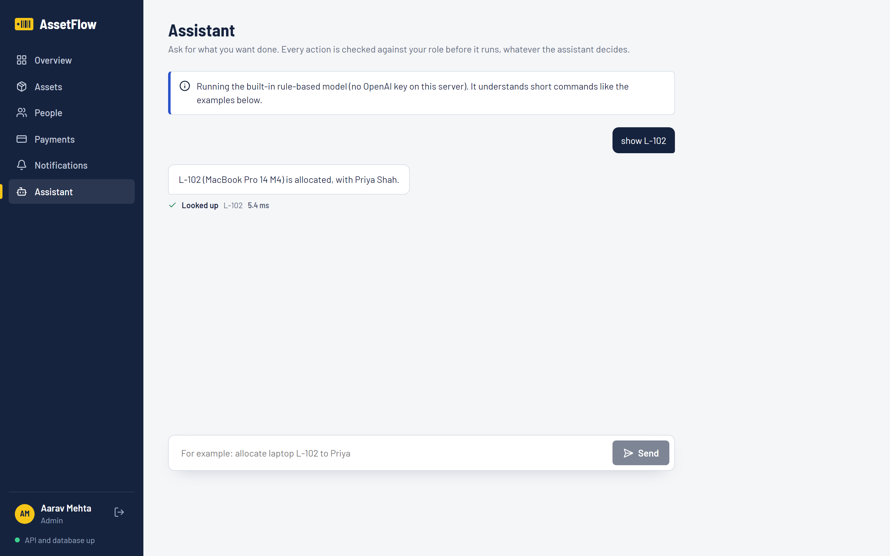
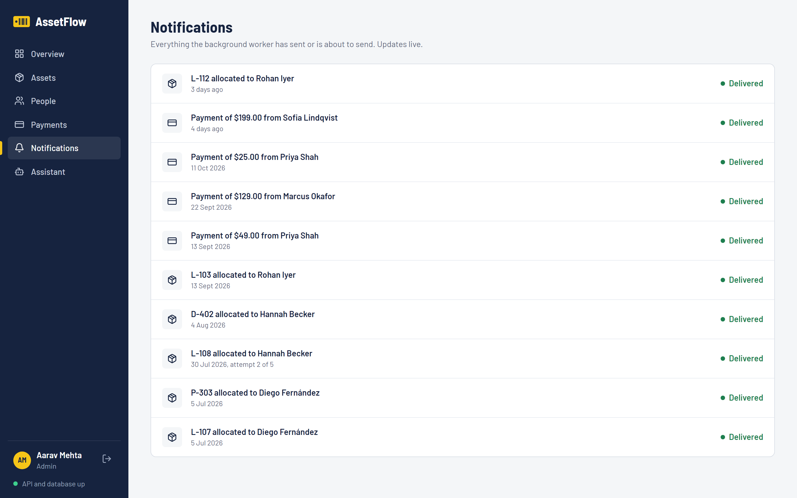
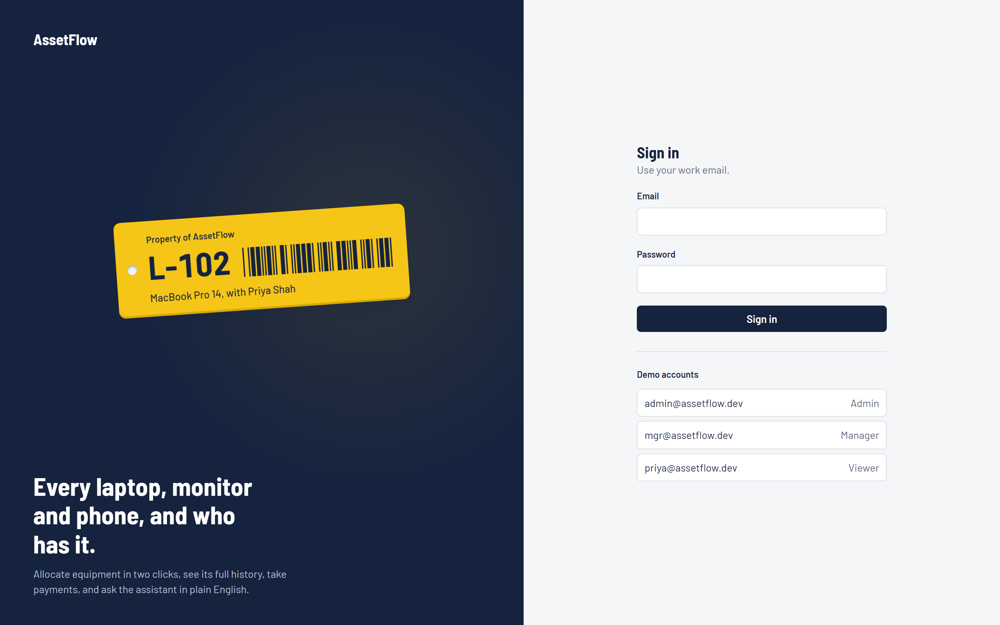
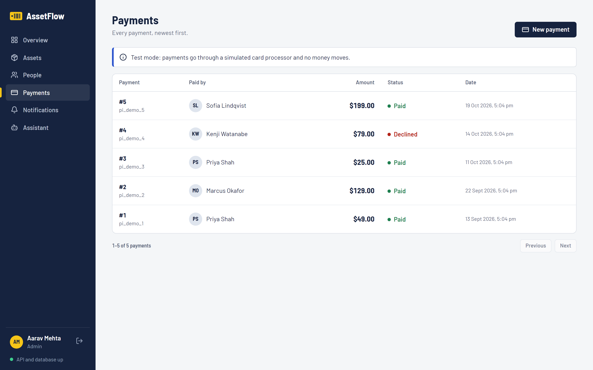
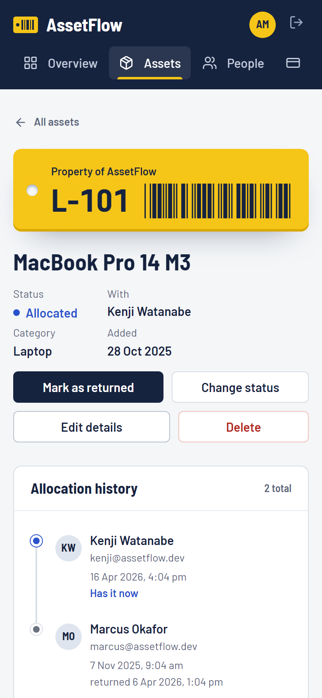

# AssetFlow web

[](https://github.com/jenish0908/assetflow-fe/actions/workflows/ci.yml)

The web interface for **[assetflow-be](https://github.com/jenish0908/assetflow-be)**,
a Go asset-management API. Every backend feature has a screen: assets and their
allocation history, people, Stripe-style payments, the notification worker's
feed, and an assistant that turns plain English into permission-checked
actions.

**Stack:** React 18 · TypeScript (strict) · Vite · React Router · TanStack Query ·
plain CSS with design tokens · Vitest + Testing Library · Playwright + axe-core ·
nginx (Docker)



| | |
|---|---|
|  |  |
|  |  |
|  |  |



## What's on each screen

| Screen | What you can do | Backend feature it uses |
|---|---|---|
| **Overview** | See where every device is (one fleet bar by status), recent allocations, the notification queue | `GET /stats` |
| **Assets** | Search by tag or name, filter by status (kept in the URL), page through; add an asset | `GET /assets?status=&q=`, `POST /assets` |
| **Asset** | Allocate to a person, mark returned, change status, edit, delete; full allocation timeline | allocate/return/status endpoints with row locks and the outbox |
| **People** | Search the directory; admins add people with a role | `GET /users?q=`, `POST /users` |
| **Payments** | Pay with a safe-to-retry form; admins see everyone's | `POST /payments` with `Idempotency-Key`, `GET /payments` |
| **Notifications** | Watch the worker deliver messages live, with attempts and errors | `GET /notifications` (polls every 3 s) |
| **Assistant** | Ask in plain English; see every tool call, its result and timing | `POST /agent/chat` |

The UI hides actions your role can't take, but it never relies on that: the API
checks every request, and the assistant's tool calls are permission-checked on
the server.

## Engineering notes

- **No N+1 in the browser either.** A table that mentions 25 holders resolves
  them with one `GET /users?ids=7,8,…` request, not 25. A component test asserts
  exactly one call (`src/pages/pages.test.tsx`), the frontend counterpart of
  the backend's [N+1 fix](https://github.com/jenish0908/assetflow-be/blob/main/docs/perf.md).
- **Payments are safe to retry.** The payment form creates one
  `Idempotency-Key` (`crypto.randomUUID()`) when it opens and sends it on every
  attempt, so pressing *Pay* again after a network error can't charge twice.
  The UI says so when the server replays an earlier result.
- **Server state lives in TanStack Query.** Each resource has one hook, and
  mutations invalidate exactly the data they change (allocating an asset
  refreshes the asset, the list, the overview and the notification feed).
  Paged tables keep the previous page on screen while the next one loads.
- **One origin, no CORS.** The browser only ever calls `/api/...`. Vite (dev) or
  nginx (Docker) forwards it to the API.
- **The barcode is real.** Asset labels render a genuine Code 39 barcode of the
  tag (`src/lib/code39.ts`), so a scanner reading the screen gets `L-102`.
- **Accessible by construction.** Native `<dialog>` for modals (focus trap and
  Esc for free), labelled controls, visible focus, `prefers-reduced-motion`
  respected. axe-core audits every page in CI.

Why it looks the way it does: [docs/DESIGN.md](docs/DESIGN.md).

## Run it

The UI needs the backend. In **assetflow-be**:

```bash
bash scripts/demo.sh          # API + worker on :8080 with realistic demo data
```

Then here:

```bash
npm install
npm run dev                   # http://localhost:5180, proxies /api to localhost:8081
API_URL=http://localhost:8080 npm run dev   # if the API is on 8080
```

Sign in with a demo account (the sign-in page lists them):
`admin@assetflow.dev` / `admin-pass-123`, `mgr@assetflow.dev` / `mgr-pass-123`,
`priya@assetflow.dev` / `priya-pass-123`.

### In Docker

With the backend stack running, this serves the production build with nginx on
port 3000 and joins the backend's network:

```bash
docker compose up -d --build  # http://localhost:3000
```

nginx sends security headers (a strict Content-Security-Policy,
`nosniff`, `DENY` framing), caches hashed build files for a year, never caches
`index.html`, and serves `index.html` for client-side routes like `/assets/12`.
Build with `--build-arg VITE_DEMO=false` to hide the demo accounts.

## Tests

```bash
npm run lint && npm run typecheck
npm test                      # 19 unit and component tests (Vitest + Testing Library)
BASE_URL=http://localhost:5180 npm run e2e   # Playwright against the real stack
```

The end-to-end suite runs against the **real** API, worker and Postgres:

- an admin adds an asset, allocates it, and the notification shows as
  *Delivered* by the background worker;
- filters narrow the list and survive a reload;
- a payment goes through and shows as paid;
- the assistant refuses an allocation for a viewer;
- viewers don't see management actions;
- no page scrolls sideways on a phone (Pixel 7);
- **axe-core finds no serious or critical WCAG 2 A/AA issues** on any page.

CI ([`.github/workflows/ci.yml`](.github/workflows/ci.yml)) runs lint (zero
warnings), type-check, unit tests and the build. It then checks out
assetflow-be, starts its stack with demo data, and runs the whole Playwright
suite against it, plus a Docker image build.

`node scripts/screenshots.mjs` regenerates the screenshots above from a
running stack.
